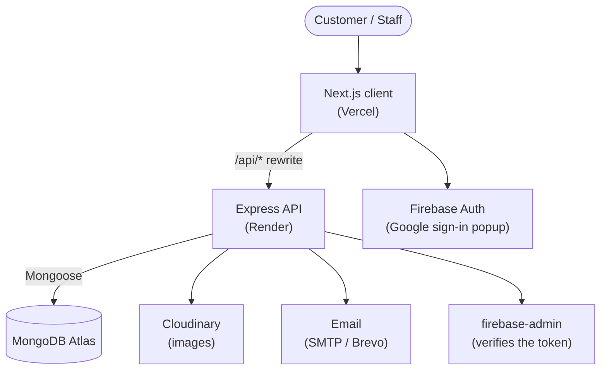

# Cartiva — Full-Stack E-Commerce Store

A **MERN-style e-commerce application**: a **Next.js** storefront and customer dashboard, a **Node.js / Express** REST API, and a **MongoDB Atlas** database. It includes a full admin panel with analytics, inventory, coupons, banners and role-based access.


---
**Live site:** `https://cartiva-7qxtte5zj-faysal-8ee5.vercel.app/`


## Table of Contents

1. [Project Overview](#1-project-overview)
2. [Application Features](#2-application-features)
3. [Technology Stack](#3-technology-stack)
4. [Project Folder Structure](#4-project-folder-structure)
5. [Application Architecture](#5-application-architecture)
6. [Pages and Navigation](#6-pages-and-navigation)
7. [API Reference](#7-api-reference)
8. [UI Components and Styling](#8-ui-components-and-styling)
9. [Installation and Running](#9-installation-and-running)
10. [Deployment](#10-deployment)
11. [Environment Variables](#11-environment-variables)
12. [Security Notes](#12-security-notes)
13. [Known Limitations](#13-known-limitations)
14. [License](#14-license)

---

## 1. Project Overview

Cartiva lets customers browse products, check out and track orders, and gives the store team a dashboard to run the shop.

- **Customers** browse and filter products, save favourites, check out with a multi-step flow, track orders, return items, leave reviews and manage their account in one dashboard.
- **Staff and admins** manage products, stock, orders, customers, coupons and banners, and watch sales analytics.

The client is a Next.js app. All business rules and data live in the Express API, which stores everything in MongoDB. Prices are shown in **Bangladeshi taka (৳)**.

> **Payments are simulated.** The checkout looks and behaves like a real gateway, but no real money moves. See [§13](#13-known-limitations).

---

## 2. Application Features

### Storefront and customer

| Area | What you can do |
|------|-----------------|
| **Authentication** | Register and log in with email and password, or continue with Google. Sessions use an httpOnly cookie. |
| **Email verification** | A 6-digit code (10-minute expiry, 5 attempts, 1-minute resend cooldown) must be confirmed before ordering. |
| **Password reset** | Emailed single-use link; a reset signs out every other device. |
| **Catalogue** | Product list with category, type, price range and sort filters, search, pagination, and a **Deals** view of discounted items. |
| **Product page** | Image gallery, colour and size options, stock count, reviews and ratings, wishlist button. |
| **Cart** | Add, remove, stock-checked quantities, saved per account. |
| **Checkout** | Address, shipping, payment and review steps. Pay by **card, bKash, Nagad or cash on delivery**. Shipping, tax and coupons are calculated on the server. |
| **Orders** | History with search, status and date filters. Status timeline, cancel (with refund for paid orders), buy again, printable invoice. |
| **Returns and reviews** | Request a return within 14 days of delivery; review products from delivered orders. |
| **Customer dashboard** | Overview with spending chart, wishlist, recently viewed, returns, reward points and tiers, profile, saved addresses, password, login activity (sign out other devices), email preferences, email change with a code, data download and account deletion. |

### Admin panel

| Area | What you can do |
|------|-----------------|
| **Dashboard** | Revenue, orders, average order value and new customers with change versus the previous period, revenue chart, order status chart, top products and alerts. |
| **Products** | Create, edit and delete; multi-image upload with reorder; **CSV import and export**; stock filters. |
| **Inventory** | Manual stock adjustments with a reason, and a full log of every stock change. |
| **Orders** | Search and filter, order detail, status changes, CSV export, printable **packing slip and shipping label**. |
| **Customers** | List with spend and order count, detail page, block or unblock, CSV export. |
| **Coupons** | Percent or fixed discounts with limits, schedules and per-customer usage. |
| **Banners** | Manage the home-page slider. |
| **Returns** | Approve, reject or mark requests refunded, with a note to the customer. |
| **Roles** | `admin`, `staff` and `viewer` (read-only). |
| **Audit log** | Who changed what, and when (admins only). |

---

## 3. Technology Stack

| Category | Technology |
|----------|------------|
| Frontend framework | **Next.js 14** (App Router), **React**, **TypeScript** |
| Styling | **Tailwind CSS** |
| UI libraries | `lucide-react` (icons), `sonner` (toasts), `recharts` (charts) |
| Backend | **Node.js**, **Express** (ES modules), `express-async-errors` |
| Database | **MongoDB Atlas** with **Mongoose** |
| Authentication | **JWT** in an httpOnly cookie, `bcryptjs`, server-side session records |
| Google sign-in | **Firebase Authentication** (client) and `firebase-admin` token verification (server) |
| Image storage | **Cloudinary** (uploads handled with `multer`) |
| Email | **Nodemailer** (SMTP) or the **Brevo** HTTPS API |
| Hosting | **Vercel** (frontend), **Render** (API), **MongoDB Atlas** (database) |

---

## 4. Project Folder Structure

`node_modules/`, `.next/` and build output are omitted.

```text
cartiva/
├── client/                              # Next.js storefront and dashboards
│   ├── src/
│   │   ├── app/                         # App Router pages
│   │   │   ├── page.tsx                 # Home
│   │   │   ├── list/                    # Product list with filters
│   │   │   ├── [slug]/                  # Product detail
│   │   │   ├── login/ · verify-email/ · forgot-password/ · reset-password/
│   │   │   ├── checkout/                # Checkout and success/[id]
│   │   │   ├── orders/[id]/             # Order detail and invoice
│   │   │   ├── profile/                 # Customer dashboard
│   │   │   ├── about/ · contact/
│   │   │   └── admin/                   # Dashboard, products, categories, orders (+ [id], slip),
│   │   │                                #   customers (+ [id]), inventory, coupons, banners,
│   │   │                                #   returns, audit
│   │   ├── components/                  # Navbar, NavLinks, Menu, CartModal, ProductList, Filter, ...
│   │   │   ├── dashboard/               # Customer dashboard sections and shared UI
│   │   │   ├── profile/                 # Avatar, Addresses, Security, AccountSettings
│   │   │   └── admin/                   # ProductForm, ImageUploader, StockModal, CsvImportModal, Pager
│   │   ├── context/                     # AuthContext, CartContext
│   │   └── lib/                         # api, firebase, card, roles, download, recent, hooks
│   ├── next.config.mjs                  # Image hosts and the /api proxy rewrite
│   └── package.json
│
└── server/                              # Express REST API
    ├── src/
    │   ├── server.js                    # App setup and route registration
    │   ├── config/db.js                 # MongoDB connection
    │   ├── models/                      # User, Product, Category, Cart, Order, Session, Review,
    │   │                                #   ReturnRequest, Coupon, Banner, InventoryLog, AuditLog
    │   ├── middleware/                  # auth (roles), error handling
    │   ├── controllers/                 # One file per feature area
    │   ├── routes/                      # auth, products, categories, cart, orders, checkout, profile,
    │   │                                #   wishlist, reviews, returns, banners, admin
    │   ├── lib/                         # pricing, gateway (simulated payments), coupons, mailer,
    │   │                                #   emailTemplates, inventory, audit, csv, tokens, money
    │   └── seed/seed.js                 # Sample categories, products and an admin account
    └── package.json
```

---

## 5. Application Architecture



- The browser only talks to the Next.js domain. A rewrite forwards `/api/*` to the Express server, so the login cookie belongs to one domain and works in every browser.
- The cookie holds a JWT that points to a **session record** in the database. Ending a session (logout, password change, "sign out everywhere") invalidates it immediately.
- Prices, shipping, tax, discounts and stock are always calculated on the server; the client only displays them.
- Checkout reserves stock atomically, claims the coupon, charges, then creates the order. A failure rolls the reservation back, and an idempotency key stops a double click from creating two orders.

---

## 6. Pages and Navigation

| Section | Routes |
|---------|--------|
| Public | `/`, `/list`, `/list?deals=1`, `/[slug]`, `/about`, `/contact` |
| Account | `/login`, `/verify-email`, `/forgot-password`, `/reset-password` |
| Checkout | `/checkout`, `/checkout/success/[id]` |
| Orders | `/orders/[id]`, `/orders/[id]/invoice` (`/orders` opens the dashboard) |
| Customer dashboard | `/profile` (sections switch in place: Overview, My orders, Wishlist, Recently viewed, Returns, Rewards, Profile, Addresses, Security, Notifications, Account) |
| Admin | `/admin`, `/admin/products`, `/admin/categories`, `/admin/orders`, `/admin/orders/[id]`, `/admin/orders/[id]/slip`, `/admin/customers`, `/admin/customers/[id]`, `/admin/inventory`, `/admin/returns`, `/admin/coupons`, `/admin/banners`, `/admin/audit` |

**Access rules**

| Role | Can do |
|------|--------|
| `user` | Shop and use their own dashboard |
| `viewer` | Read the admin area; every change is refused |
| `staff` | Create and edit products, orders, stock, coupons, banners and returns |
| `admin` | Everything, including deletes, blocking customers, changing roles and the audit log |

---

## 7. API Reference

All routes are under `/api`. Responses are JSON; errors look like `{ "message": "..." }`.

| Group | Routes |
|-------|--------|
| Health | `GET /health` |
| Auth | `POST /auth/register`, `/auth/login`, `/auth/logout`, `/auth/google`, `/auth/verify-email`, `/auth/resend-verification`, `/auth/forgot-password`, `/auth/reset-password`; `GET /auth/me` |
| Catalogue | `GET /products` (filters: `name`, `type`, `min`, `max`, `cat`, `sort`, `deals`, `stock`, `page`, `limit`), `GET /products/:slug`, `GET /categories`, `GET /banners` |
| Cart | `GET /cart`, `POST /cart`, `DELETE /cart/:itemId` |
| Checkout | `GET /checkout/quote`, `POST /checkout` |
| Orders | `GET /orders`, `GET /orders/:id`, `POST /orders/:id/cancel`, `POST /orders/:id/reorder` |
| Profile | `GET /profile`, `PUT /profile`, `PUT /profile/password`, `PUT /profile/preferences`, `GET /profile/overview`, addresses, email change, sessions, `GET /profile/export`, `DELETE /profile` |
| Engagement | `/wishlist`, `/reviews`, `/returns` |
| Admin | `/admin/stats`, `/admin/orders`, `/admin/customers`, `/admin/inventory`, `/admin/products/import`, `/admin/products/export`, `/admin/upload`, `/admin/coupons`, `/admin/banners`, `/admin/returns`, `/admin/audit` |
| Write access | Product and category writes need `staff` or `admin`; deletes need `admin` |

---

## 8. UI Components and Styling

**Tailwind CSS** is used throughout, with a single accent colour defined in the Tailwind config as `lama` (used as `bg-lama`, `text-lama`).

| Component | Purpose |
|-----------|---------|
| `Navbar`, `NavLinks`, `Menu` | Navigation with active-link highlight and a mobile drawer |
| `ProductList`, `Filter`, `ProductImages`, `CustomizeProducts` | Catalogue, filters, gallery and options |
| `CartModal` | Cart popup that leads to checkout |
| `dashboard/ui` | Shared cards, buttons, inputs, modal, toggle, stars, skeletons and empty states |
| `ImageUploader` | Drag-and-drop upload with reorder |
| `StockModal`, `CsvImportModal`, `Pager` | Admin tools |

The interface uses skeleton loaders, empty states with a call to action, toast messages, confirm dialogs and a print stylesheet for invoices and packing slips.

---

## 9. Installation and Running

**You need:** Node.js 20 or newer, Git, and a MongoDB Atlas database.

```bash
git clone <your-repository-url>
cd cartiva

# API
cd server
npm install
cp .env.example .env        # or create .env (see section 11)
npm run seed                # sample categories, products and an admin account
npm run dev                 # http://localhost:5000

# Storefront (second terminal)
cd client
npm install
npm run dev                 # http://localhost:3000
```

Restart both servers after changing any `.env` file.

**Useful scripts**

| Where | Script | Purpose |
|-------|--------|---------|
| `server` | `npm run dev` | API with auto-reload |
| `server` | `npm start` | API for production |
| `server` | `npm run seed` | Wipes and recreates categories and products, and adds the admin account if missing |
| `client` | `npm run dev` / `build` / `start` | Development, production build, production server |

**Test payment values** (simulation only)

| Method | Value | Result |
|--------|-------|--------|
| Card | `4242 4242 4242 4242` | Approved |
| Card | `4000 0000 0000 0002` | Declined |
| Card | `4000 0000 0000 9995` | Insufficient funds |
| bKash / Nagad | any `01XXXXXXXXX` number with code `123456` | Approved |
| bKash / Nagad | code `000000` | Insufficient balance |

Use any future expiry date and any 3-digit CVC for cards.

---

## 10. Deployment

| Part | Host | Notes |
|------|------|-------|
| Database | MongoDB Atlas | Network Access must allow the API host. |
| API | Render (web service) | Root directory `server`, build `npm install`, start `npm start`, health check `/api/health`. The free plan sleeps when idle, so the first request can be slow. |
| Client | Vercel | Root directory `client`. |
| Images | Cloudinary | Needed because the API host's disk is not permanent. |

**Order of setup**

1. Deploy the API and open `/api/health`.
2. Deploy the client with `API_INTERNAL_URL` set to the API address.
3. Set `CLIENT_URL` on the API to the client address, exactly, with no trailing slash.
4. Add the client domain under **Firebase, Authentication, Settings, Authorized domains**.
5. Create a Cloudinary API key with a role that allows uploads, and add it to the API's environment.

The API must run with `NODE_ENV=production` and `trust proxy` enabled (already set in `server.js`) so secure cookies and client IPs work behind the host's proxy.

---

## 11. Environment Variables

**Server (`server/.env`, or the host's Environment tab)**

| Variable | Purpose |
|----------|---------|
| `PORT` | Local port (the host sets this in production) |
| `MONGO_URI` | MongoDB Atlas connection string, including the database name |
| `JWT_SECRET` | Long random string used to sign login cookies and hash codes |
| `CLIENT_URL` | Exact address of the frontend (used for CORS and email links) |
| `SERVER_URL` | Public address of the API |
| `NODE_ENV` | `development` or `production` |
| `FIREBASE_PROJECT_ID` | Enables Google sign-in verification |
| `CLOUDINARY_CLOUD_NAME`, `CLOUDINARY_API_KEY`, `CLOUDINARY_API_SECRET` | Image uploads |
| `BREVO_API_KEY` | Sends email over HTTPS (optional) |
| `SMTP_HOST`, `SMTP_PORT`, `SMTP_USER`, `SMTP_PASS` | Sends email over SMTP (optional) |
| `MAIL_FROM` | Sender, for example `Cartiva <you@example.com>` |

With no email settings, emails are printed in the server terminal instead of being sent, which is useful in development.

**Client (`client/.env.local`, or Vercel's Environment Variables)**

| Variable | Purpose |
|----------|---------|
| `API_INTERNAL_URL` | Address of the API that `/api/*` is forwarded to (server-side only) |
| `NEXT_PUBLIC_FIREBASE_API_KEY`, `NEXT_PUBLIC_FIREBASE_AUTH_DOMAIN`, `NEXT_PUBLIC_FIREBASE_PROJECT_ID`, `NEXT_PUBLIC_FIREBASE_APP_ID` | Firebase web config for the Google button |

`NEXT_PUBLIC_*` values are embedded in the browser code and visible to everyone. **Never put secrets in them.** Keep `.env` files out of Git.

---

## 12. Security Notes

- Passwords are hashed with bcrypt. Verification codes and reset tokens are stored only as hashes.
- Login cookies are `httpOnly`, `SameSite=Lax` and `secure` in production, and are tied to a revocable server-side session.
- Verification codes allow 5 attempts; resend and reset requests have cooldowns.
- Uploads are limited to 5 MB, and the file type is detected from the file's content, not its name.
- Card details are never stored. Only the brand and last four digits are kept on an order.
- Roles are enforced on the server; hiding a button in the UI is never the only protection.
- CSV exports neutralise spreadsheet formulas.

---

## 13. Known Limitations

- **Payments are a simulation.** No real money is charged. Moving to a real gateway means replacing `server/src/lib/gateway.js` and the card form, because real gateways collect cards on their own hosted page.
- **No rate limiting or `helmet` yet.** Add both (especially on login, register and checkout) before real traffic.
- **No automated tests.**
- The free Render plan sleeps when idle, and free hosts often block SMTP ports, which is why an HTTPS email option exists.
- Reward points are earned but cannot be redeemed yet, and the "offers and news" preference is saved but no promotional emails are sent.
- Cancelling an order does not give a coupon use back.
- Recently viewed products are stored per browser, not per account.
- Deleting a product or banner leaves its image in Cloudinary.
- Change the seeded admin account before sharing the site, and use a strong `JWT_SECRET`.

---

## 14. License

See the [LICENSE](./LICENSE) file.
